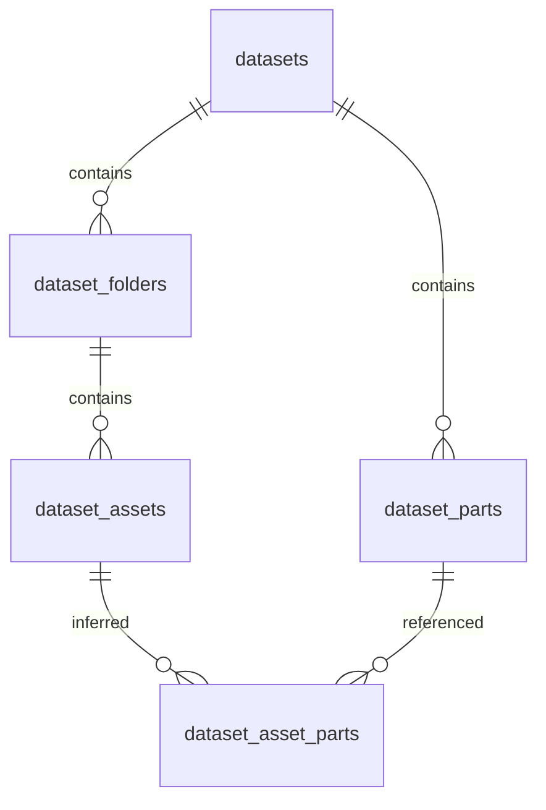

# E783 데이터셋 DB / Dataset database

## 공개 조회 화면 / Public viewer

공개 주소의 첫 화면은 이제 메인 프런트엔드입니다. 데이터셋 조회는 **E783 dataset** 탭 또는 `datasets.html`에서 열립니다. 영어 데이터셋 주소는 `datasets.html?lang=en`입니다. 공개 메인 화면의 사진 업로드·AI 인식은 서버 미연결 상태로 비활성화되어 있습니다.

사용자 요청에 따라 [공개 페이지](https://jun123-a.github.io/kamero-printer-part-recognition/)를 로컬 데이터셋 화면과 같은 영상 조회 방식으로 복원했습니다. **31개 부품과 538개 영상 항목**, 부품별 필터, 파일명·폴더·크기·Drive 링크를 제공합니다. 영어는 주소 끝에 `?lang=en`을 붙입니다. 공개 JSON에도 이 영상 정보가 포함되며 누구나 내려받을 수 있습니다. Drive 공유 권한은 변경하지 않았습니다.

At the user's request, the public viewer again includes 31 parts and 538 video entries, part filtering, filenames, folders, sizes and Drive links. These fields are available in the public JSON snapshot. Drive permissions are unchanged. The local app reads SQLite through FastAPI; the public site reads exported JSON and does not connect to the local database.

로컬 원본 저장소는 SQLAlchemy로 관리하는 SQLite DB(`app/data/local.db`)입니다. 공개 사이트는 여기서 내보낸 `docs/catalogue.json`을 JavaScript로 읽습니다. JSON은 DB 자체가 아니라 공개용 복사본입니다. DB 갱신 후 `.venv\Scripts\python.exe app/export_public_catalog.py`를 실행하고 `docs/` 변경을 main에 올려야 공개 화면에도 반영됩니다. 영상 원본은 JSON에 들어 있지 않고 Drive에 있습니다.

## 등록한 내용

2026-10-15 제공된 Drive 목록과 사용자 제공 **E783_Component_Part_Information - Sheet1.pdf** 1–2쪽을 기준으로 정리했습니다.

| 항목 | 결과 |
|---|---:|
| PDF의 부품 번호 | 1–31, 누락 없음 |
| 폴더 | 32 (All_Parts + Part_1–Part_31) |
| 영상 파일 항목 | 538 |
| 파일 크기 합계 | 8,234,274,440 bytes |
| 이름·크기가 같은 중복 후보 그룹 | 269 |
| 파일명 또는 폴더명으로 부품에 연결된 항목 | 538 |

**538개는 Drive 파일 항목 수입니다.** 파일 이름과 크기가 같아도 내용이 동일하다는 검증은 하지 않았습니다. 파일을 삭제하거나 병합하지 않습니다. 동영상 자체를 다운로드하거나 프레임을 추출한 상태가 아닙니다.

PDF의 Part No.를 Part_N 폴더에 연결했습니다. PDF의 체크 표시는 문서상 수신·업로드 표시이며, 영상 내용을 검증했다는 뜻이 아닙니다. 모델명 E783은 문서 이름에서 가져온 데이터셋 표제이며, 다른 프린터와의 호환성 정보는 없습니다.

## 테이블과 연결



- `datasets`: 출처, 수집 시각, 입력 목록과 부품표의 SHA-256. 이는 입력 JSON 해시이며 영상 해시가 아닙니다.
- `dataset_parts`: 데이터셋 내 Part No., SVC Part Number, 설명. 기존 `parts`와 별도 테이블이며 SVC 번호가 우연히 같아도 자동 병합하지 않습니다.
- `dataset_folders`: 원본 폴더명과 Drive ID.
- `dataset_assets`: Drive 파일 ID, 원본 링크, 파일 크기, 수정 시각, 중복 후보 그룹.
- `dataset_asset_parts`: 영상과 부품의 다대다 연결 및 근거(`filename` 또는 `folder`).

`5&6_1.mp4`는 5, 6에, `2-3-5-6-7_1.mp4`는 2, 3, 5, 6, 7에 연결됩니다. 이는 파일명 추정이며 박스 주석이나 실제 영상 검증 결과가 아닙니다. 파일명을 해석할 수 없으면 Part_N 폴더를 사용하고, 둘 다 없으면 미연결로 남깁니다.

## 실행

기존 README대로 환경을 설치한 뒤 저장소 루트에서 실행합니다.

```powershell
.venv\Scripts\python.exe app/import_dataset.py app/data/dataset_inventory.json
.venv\Scripts\python.exe -m unittest discover -s app -p "test_*.py" -v
start-kamero.cmd
```

브라우저에서 `http://127.0.0.1:8000/datasets`를 엽니다. 인식 화면 상단의 **E783 dataset** 링크로도 이동할 수 있습니다.

로컬 DB는 `app/data/local.db`입니다. 가져오기 전에 SQLite backup API로 `app/data/backups/`에 일관된 백업을 만듭니다. 새 테이블만 추가하므로 기존 부품과 인식 기록을 보존합니다. 가져오기는 하나의 트랜잭션이며 오류가 나면 데이터 변경을 롤백합니다.

동일한 목록을 다시 가져와도 파일/부품 행이 늘어나지 않습니다. 원본 ID가 같은 항목의 메타데이터와 추정 연결을 갱신합니다. 나중 목록에서 사라진 항목은 자동 삭제하지 않습니다. 따라서 요약은 최신 스냅샷만의 수가 아니라 보존된 누적 목록입니다.

## 입력 목록 형식

Drive 수집 결과 `app/data/dataset_inventory.json`은 로컬에만 있습니다. GitHub에는 원본 동영상, DB, Drive 파일별 링크 목록, PDF를 넣지 않습니다. 부품 정보는 `app/catalogs/e783_parts.json`에 재현 가능한 매핑으로 포함합니다.

다른 컴퓨터에서는 권한이 있는 사람이 Drive 파일 목록을 아래 형식으로 준비해야 합니다. 이 도구는 Drive 인증/다운로드 프로그램이 아닙니다. 한 단계 폴더 구조만 지원합니다.

```json
{
  "schema_version": 1,
  "root_id": "EXAMPLE_ROOT",
  "source_url": "https://drive.google.com/drive/folders/EXAMPLE_ROOT",
  "name": "E783 source videos",
  "collected_at": "2026-10-15T00:00:00Z",
  "complete_listing": true,
  "nodes": [
    {"id": "FOLDER", "name": "Part_1", "mime_type": "application/vnd.google-apps.folder", "parent_id": "EXAMPLE_ROOT"},
    {"id": "VIDEO", "name": "1_1.mp4", "mime_type": "video/mp4", "parent_id": "FOLDER", "size_bytes": 123, "url": "https://drive.google.com/file/d/VIDEO/view", "modified_time": null}
  ]
}
```

## 백엔드 조회 API

| GET 경로 | 용도 |
|---|---|
| /api/datasets | 데이터셋 목록 |
| /api/datasets/1/summary | 개수와 준비 상태 |
| /api/datasets/1/parts | 부품 번호·SVC 번호·설명 |
| /api/datasets/1/assets?part_no=5&offset=0&limit=50 | 부품별 영상 목록 |

ID는 목록 API 결과를 사용하세요. limit은 1–200입니다. 읽기 전용 API이며 기존 로컬 프로토타입과 동일하게 인증은 없습니다. Drive 링크 접근 권한은 Drive가 확인합니다.

## 이후 학습 작업

실제 중복 여부는 영상 해시/내용으로 확인해야 합니다. 촬영 세션과 원본 영상 단위로 train/validation/test를 나눈 다음 프레임을 추출하고 학습 세트에만 증강을 적용해야 합니다. 동일 원본 후보들이 서로 다른 분할로 들어가지 않도록 검토해야 합니다.

현재 DB에 학습 분할이나 박스 라벨은 없습니다. API는 이를 각각 `unassigned`, `not_provided`로 명시합니다. 이 DB를 만들었다고 기존 YOLO 모델이 새 31개 부품을 인식하게 되는 것은 아닙니다. 새 모델과 클래스 매핑을 준비한 뒤 인식 API에 별도로 연결해야 합니다.

## English

This additive SQLAlchemy/SQLite catalogue imports 31 E783 parts from the supplied PDF and 538 Drive video entries across 32 folders. It preserves the legacy 40-class recognition catalogue and detection history. Part numbers belong to the new dataset namespace, even if an SVC number also occurs in the legacy catalogue.

The 269 filename/size groups are **duplicate candidates**, not verified content duplicates. All source entries remain. Video-to-part links are inferred from filenames, falling back to Part_N folders; multi-part filenames create multiple links. These are not visual annotations.

Run the import command above with an authorized local inventory. Imports are transactional and idempotent; the CLI backs up the existing SQLite database before adding tables or importing rows. Missing items in later inventories are retained, so summaries cover the accumulated catalogue.

Open `/datasets` for filtering, pagination and Drive links, or use the read-only APIs listed above. The public repository includes code, the document-derived part mapping and tests; it excludes runtime databases, media, the source PDF and private Drive inventories. Another workstation must supply its own authorized inventory; this importer does not authenticate to Drive or download videos.

No videos were downloaded, no frames or boxes were annotated, and no training split was assigned. Verify duplicates and capture sessions before splitting at source level. Training or integrating a model for these 31 parts remains a separate step.
